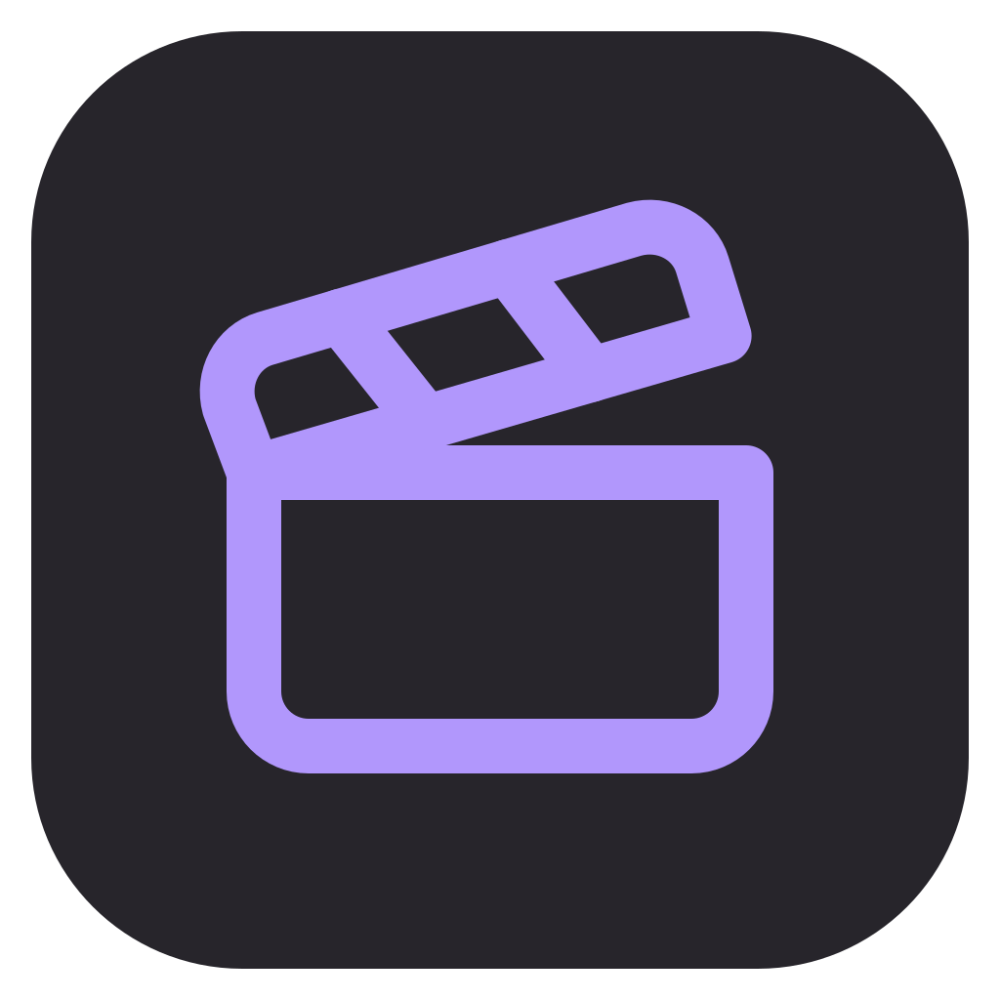

    
    <h1>AcroClip</h1>
    

        Clip it. Watch it. Share it.
         
        Managing your clips has never been easier.
    

    <a href="https://github.com/noomstuff/acroclip/releases">
        Download
    </a>

---

AcroClip is a simple, lightweight clipping tool. I made it because a friend wanted a Medal alternative that doesn't train AI on your clips or shove ads in your face.

Pick a screen, an application, or a game, and press a shortcut to clip the last few moments. Your clips land in the library, where you can rewatch them in the built-in player.

You can also create Shareables: smaller copies of your clips that are easier to send to friends.

## Downloads

Grab the latest version from the [releases page](https://github.com/noomstuff/acroclip/releases). Installer and portable versions are available.

---

## For developers

See [CONTRIBUTING.md](CONTRIBUTING.md) to set up a development environment and build AcroClip from source.

PRs welcome. AcroClip is [GPL-3.0 licensed](LICENSE); bundled third-party components are listed in [THIRD_PARTY_NOTICES.md](THIRD_PARTY_NOTICES.md).
