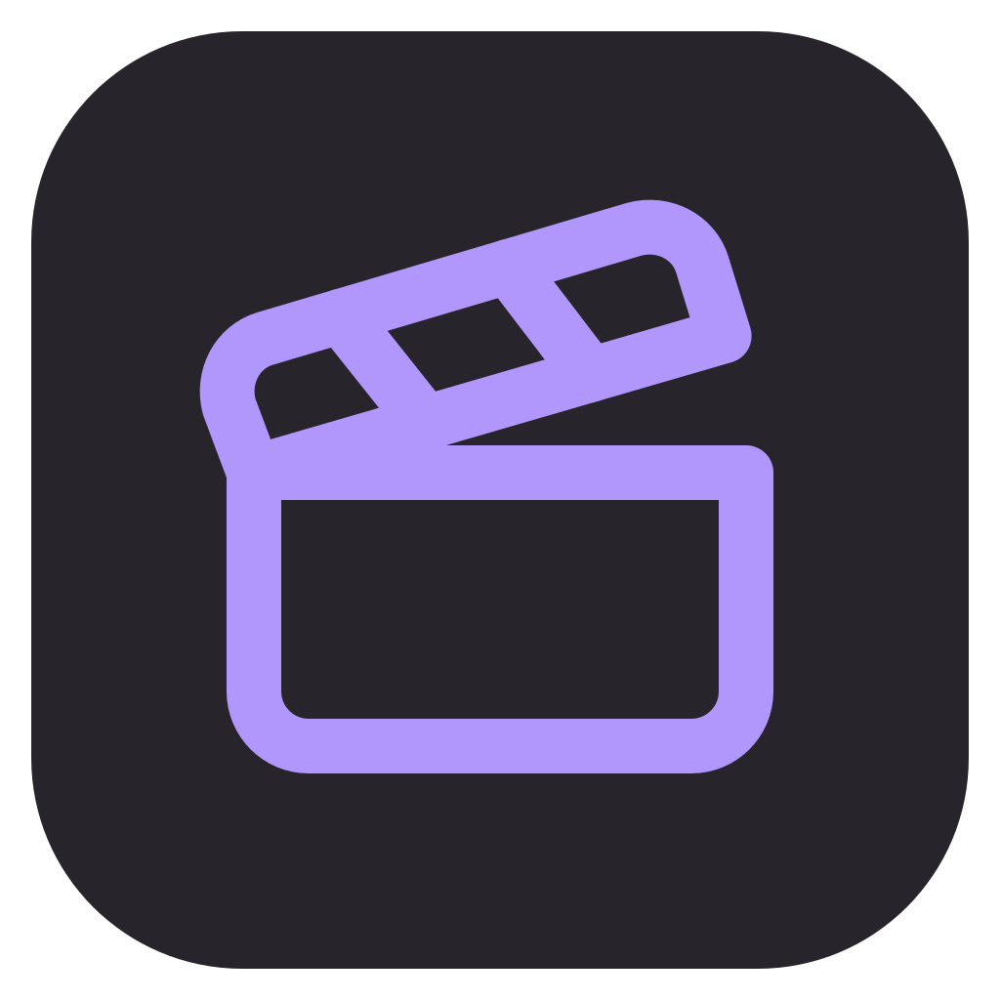

    
    <h1>AcroClip</h1>
    

        Clip it. Watch it. Share It.
         
        Managing your clips has never been easier.
    

    <a href="https://github.com/noomstuff/acroclip/releases">
        Download
    </a>

---

AcroClip is a simple, lightweight clipping tool. Made because my friend wanted a Medal alternative that doesn't train AI on your clips or shove ads in your face.

Pick a screen, an application, or a game. Press a shortcut to clip. Manage your clips in the library, and watch them in the built-in video player.

You can create Sharables: smaller versions of the original clips that are easier to share with friends.

## Downloads

If you just want to use the app you can grab the latest version from the [releases page](https://github.com/noomstuff/acroclip/releases).

Portable and installer versions are available.

---

## For developers

You can get started with the [CONTRIBUTING.md](CONTRIBUTING.md) guide to set up a development environment and build AcroClip from source.

PRs welcome. [GPL-3.0 licensed](LICENSE). Recorded videos never inherit the software license, and code reused from AttaCut keeps its MIT notice.
